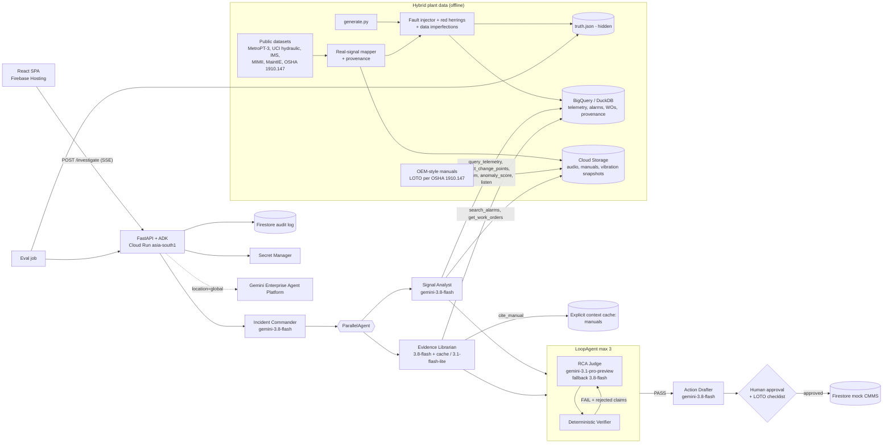

# Architecture — Andon Agent

## 1. Layers

| Layer | Components | Runs on |
|---|---|---|
| Plant data (offline) | `scripts/fetch_datasets.py` (public datasets, checksums) → `simulator/` synthetic line + real-signal mapping + fault injector + imperfections + text artifacts + manuals + provenance; `truth.json` (hidden from agents) | Local / Cloud Run Job |
| Data | Telemetry + alarms + work orders + provenance (BigQuery, DuckDB locally) · audio, manual PDFs, raw vibration snapshots (Cloud Storage) · manuals text (explicit context cache) | asia-south1 (Gemini: global) |
| Agents | ADK graph: Commander → Parallel(Signal Analyst, Evidence Librarian) → Loop(RCA Judge ↔ Verifier, max 3) → Action Drafter | Inside the API container |
| Serving | FastAPI: `/investigate` (SSE), `/approve`, `/replay`, `/healthz` · Firestore sessions, audit log, mock CMMS | Cloud Run asia-south1 |
| UI | React SPA: line mimic, live agent trace, RCA panel with verifier badges, approval gate | Firebase Hosting |
| Eval | `eval/` harness, baselines, metrics → results JSON + slide PNG | Cloud Run Job |

## 2. Diagram



## 3. Request lifecycle
1. UI `POST /api/incidents/{scenario_id}/investigate` → server opens SSE stream, creates `incident_id`, ADK session.
2. Commander calls `get_stop_event`, `list_assets`, emits a `plan` event (ordered list of checks).
3. Signal Analyst and Evidence Librarian run in parallel. Every tool call emits `tool_call` then `tool_result` (with an `evidence_id`). All tool results are stored in session state keyed by `evidence_id`.
4. RCA Judge emits `hypotheses` (structured `RCAReport` draft). Every claim references `evidence_id`s.
5. Verifier re-executes each referenced evidence query and checks each claim → emits `claim_verdict` per claim and a `verifier_verdict`. On FAIL, rejected claims go back to the Judge (max 3 loops).
6. On PASS (or loop exhaustion → `insufficient_evidence`), emits `rca_final`.
7. Action Drafter emits `work_order_draft` with status `PENDING_APPROVAL` and verbatim LOTO citations.
8. Server emits `cost` (tokens, $, cache savings) and `done`. Heartbeat comment every 15 s throughout.
9. Human accepts/edits RCA and ticks LOTO checklist in UI → `POST /api/incidents/{id}/approve` → mock CMMS record + audit entry.

## 4. Contracts

### 4.1 `agents/schemas.py` (Pydantic v2; keep nesting ≤3 levels for response_schema)
```python
CONTRACT_VERSION = "1.0.0"

class CauseClass(StrEnum):  # exactly the 11 simulator fault classes + NO_FAULT
    WELD_TIP_WEAR = "weld_tip_wear"; SEALER_PUMP_CAVITATION = "sealer_pump_cavitation"
    CONVEYOR_BEARING_DEFECT = "conveyor_bearing_defect"; SERVO_OVERHEAT = "servo_overheat"
    AIR_PRESSURE_DROP = "air_pressure_drop"; SENSOR_DRIFT = "sensor_drift"
    PLC_TIMER_MISCONFIG = "plc_timer_misconfig"; COOLANT_BLOCKAGE = "coolant_blockage"
    FIXTURE_MISALIGNMENT = "fixture_misalignment"; CHANGEOVER_ERROR = "changeover_error"
    HYDRAULIC_DEGRADATION = "hydraulic_degradation"
    NO_FAULT = "no_fault"

class ProvenanceRef(BaseModel):
    source_id: str              # "synthetic" | "metropt3" | "uci_hydraulic" | "ims_bearings" | "mimii" | ...
    real: bool
    source_ref: str | None = None   # rows/files used, from the provenance table

class Evidence(BaseModel):
    evidence_id: str            # "ev_<tool>_<n>"
    tool: str                   # tool name that produced it
    args: dict                  # exact args, so the verifier can re-run it
    summary: dict               # numeric/structured result (no prose)
    provenance: list[ProvenanceRef]
    produced_at: datetime

class Claim(BaseModel):
    claim_id: str
    text: str                   # human-readable
    kind: Literal["numeric", "temporal", "citation", "causal_order", "qualitative"]
    evidence_ids: list[str]
    asserted_value: float | None = None
    asserted_ts: datetime | None = None
    citation: "Citation | None" = None

class Citation(BaseModel):
    doc: str; page: int; quote: str   # quote must exist verbatim in cached manual text

class Hypothesis(BaseModel):
    cause_class: CauseClass
    asset_id: str
    confidence: float = Field(ge=0, le=1)
    causal_chain: list[str]          # asset/event steps, root first
    claims: list[Claim]
    refuting_evidence_ids: list[str] = []
    next_check: str | None = None

class RCAReport(BaseModel):
    incident_id: str
    hypotheses: list[Hypothesis]     # ranked, max 3
    status: Literal["verified", "insufficient_evidence"]

class ClaimVerdict(BaseModel):
    claim_id: str; verdict: Literal["pass", "fail", "unverifiable"]; reason: str
    measured_value: float | None = None

class VerifierVerdict(BaseModel):
    overall: Literal["PASS", "FAIL"]; claims: list[ClaimVerdict]; iteration: int

class WorkOrderStep(BaseModel):
    order: int; text: str; is_safety: bool; citation: Citation | None = None

class WorkOrder(BaseModel):
    wo_id: str; incident_id: str; asset_id: str; cause_class: CauseClass
    steps: list[WorkOrderStep]; parts: list[str]
    status: Literal["PENDING_APPROVAL", "APPROVED", "REJECTED"] = "PENDING_APPROVAL"
```

### 4.2 `api/events.py` — SSE event union (frontend contract)
Every event: `{"type": ..., "incident_id": str, "seq": int, "ts": iso8601, "agent": str | null, "data": {...}}`

| `type` | `data` | UI effect |
|---|---|---|
| `incident_started` | `{scenario_id, line_id, stopped_station, mode: "live"|"replay"}` | Line mimic turns station red; cost counter starts |
| `plan` | `{steps: [str]}` | Plan card at top of trace |
| `agent_started` / `agent_finished` | `{agent, model_id}` | Agent lane header |
| `tool_call` | `{call_id, tool, args}` | Tool card (spinner) |
| `tool_result` | `{call_id, evidence_id, summary, provenance: [ProvenanceRef], latency_ms}` | Tool card resolves; evidence chip; "REAL DATA · MetroPT-3" provenance chip when `real` |
| `cache_hit` | `{cache_name, cached_tokens, saved_usd}` | Cache badge |
| `hypotheses` | `RCAReport` (draft) | Hypothesis cards (unverified state) |
| `claim_verdict` | `ClaimVerdict` | Green tick / red strike-through on the claim |
| `verifier_verdict` | `VerifierVerdict` | Loop counter; "revising…" if FAIL |
| `model_fallback` | `{from_model, to_model, reason}` | Small amber note in trace |
| `rca_final` | `RCAReport` | RCA panel locks; Accept/Edit/Reject enabled |
| `work_order_draft` | `WorkOrder` | WO panel; LOTO checklist; Approve disabled until ticked |
| `cost` | `{input_tokens, output_tokens, cached_tokens, usd, by_model: {...}}` | Cost chip |
| `error` | `{code, message, retryable}` | Inline error, never a blank screen |
| `done` | `{duration_ms}` | Stream closes |

Heartbeats are SSE comments (`: ping`), not events.

### 4.3 `simulator/truth_schema.py`
```python
class GroundTruth(BaseModel):
    scenario_id: str; seed: int
    scenario_set: Literal["synthetic", "real_signal"]
    truth_source: Literal["injected", "source_label"]   # source_label = from the dataset's own labels/failure reports
    variant: Literal["clean", "red_herring", "dual_fault", "no_fault"]
    root_cause_class: CauseClass; asset_id: str | None; onset_ts: datetime | None
    detail: str | None = None        # e.g. hydraulic sub-type "pump_leakage_severe"
    causal_chain: list[str]; secondary_cause: CauseClass | None = None
    distractors: list[str]           # planted misleading artifacts
    imperfections: list[str] = []    # injected data-quality issues (gaps, stuck values, chatter, skew)
    stop_station: str; stop_ts: datetime
```

## 5. Storage decisions
- **Manuals → explicit context cache (long context), not vector search.** <200K tokens total, reused on every incident, full of cross-references. TTL 60 min, deleted at session end.
- **Work orders and alarms → SQL on (asset_id, time window).** They have keys; embeddings add nothing at this size. Vector search is the documented scale path (>1M WOs).
- **Session state → ADK session (Firestore-backed).** **Audit → append-only Firestore collection** `audit/{incident_id}/steps/{seq}` holding every model call, tool call, verdict and human action; the same records power replay mode and the eval.

## 6. Non-functional targets (assumptions — validate on Day 4)
p50 full diagnosis ≤ 60 s, p95 ≤ 120 s · cost per diagnosis ≤ $0.60 with Pro judge · cold start ≤ 10 s · zero unverified claims rendered as verified · every real-sourced evidence item carries provenance.

## 7. Gemini capability coverage (what the Innovation criterion names, where it lives, where judges see it)
| Capability | Where in the system | Visible in demo at |
|---|---|---|
| Agentic reasoning / planning | Commander plan; Judge competing hypotheses; loop revision after verifier FAIL | 0:42 plan card · 1:30 revision |
| Function calling | 10+ read-only analytics/SQL tools, 1 gated write tool | 0:42–1:12 tool cards |
| Multimodality (audio) | `listen()` on MIMII clips via `gs://` | ~1:00 audio tool card |
| Long context + explicit context caching | 5 manuals (<200K tokens) cached per session; cache-hit + saved-$ badge | 1:12 citation card |
| Structured output | `RCAReport`, `WorkOrder` via response_schema, Pydantic-validated | 1:48 collapsible JSON |
| Thinking levels + cost routing | LOW for loops, HIGH for judge; Flash-Lite / Flash / Pro routing with fallback | cost chip, fallback badge |
| Grounded verification (non-LLM) | deterministic verifier re-executes evidence | 1:30 struck-through claim |
| (Stretch) multimodal input from the floor | technician voice note → Gemini audio → shift note | technician view, if built |

## 8. Stretch endpoints (only after the core passes freeze-gate items; see DEVELOPMENT.md §9b)
- `POST /api/ingest/csv` — "bring your own historian export": upload ≤20 MB CSV → Flash-Lite proposes a column→tag mapping (structured output) → **human confirms** → loaded as a temporary scenario `U###` with `provenance: user_upload` → normal investigation. Proves the adapter pattern behind the scale story (OPC UA/MQTT later).
- `POST /api/incidents/{id}/voice-note` — ≤60 s audio from the technician view → Gemini audio → structured shift note (untrusted data, same wrapping rules).
- `GET /api/incidents/{id}/work-order?lang=hi|ta|id|vi` — WO summary translated for the technician; **safety steps stay verbatim in the manual's language** with a side-by-side translation labelled "machine translation — not the controlling text".

## 9. Observability
Structured JSON logs (one line per event, `incident_id` on every line) → Cloud Logging. Per-run metrics in the audit log (tokens, $, latency by agent). Optional: ADK/OpenTelemetry export to Cloud Trace if it works within 30 minutes — a trace screenshot is a strong architecture-slide asset; skip it otherwise.
